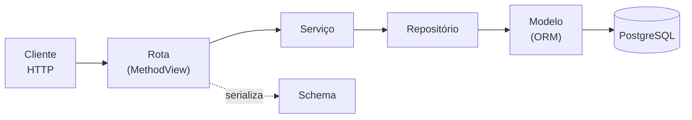
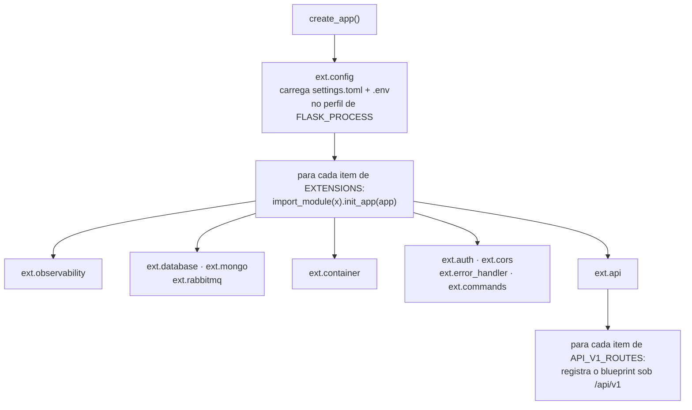

# Arquitetura

## Os dois eixos

A arquitetura tem **duas** dimensões independentes. Confundi-las é a origem da maior parte
da confusão em projetos assim.

**Eixo vertical — por onde a requisição passa.** Quatro camadas, cada uma conhecendo
apenas a de baixo:



**Eixo horizontal — como a aplicação é montada.** Acontece uma única vez, na
inicialização. O `create_app()` não conhece nenhuma extensão nem nenhuma rota: ele lê duas
listas de caminhos de módulo do `settings.toml` e importa cada uma.



A consequência prática: **nenhuma funcionalidade nova exige editar `app.py`.** Você cria um
módulo e acrescenta uma linha na configuração.

### Um perfil por processo

A mesma imagem roda mais de um processo, e cada um carrega só o que usa. A variável
`FLASK_PROCESS` escolhe uma seção do `settings.toml`, o **perfil**. As chaves do perfil valem
sobre as do `[default]`, e uma lista declarada no perfil (`EXTENSIONS`, `API_V1_ROUTES`)
substitui a do `[default]` inteira. A extensão ou a rota que fica fora da lista do processo não
é importada, não exige configuração e não aparece no health dele. O container liga só as rotas
do perfil. Os serviços e repositórios, porém, ficam todos declarados no `ext/container.py`,
comum aos processos HTTP.

| Perfil | Quem roda | Dependências | Rotas |
|---|---|---|---|
| `[default]` (sem `FLASK_PROCESS`) | desenvolvimento local e a suíte de testes | todas: é a união dos perfis | todas |
| `[api]` | serviço `api` do compose: login e as rotas de negócio; é ele que publica na fila | Postgres e RabbitMQ | `health`, `auth`, `item`, `vehicle` |
| `[bronze_api]` | serviço `bronze-api`: a API da camada silver, que lê o bronze (por enquanto, só login) | Postgres e Mongo | `health`, `auth` |
| `[consumer]` | o consumer da fila, que grava no bronze (ainda sem serviço no compose) | Mongo e RabbitMQ (sem Postgres e sem JWT) | nenhuma |
| `[setup]` | o job `setup`: migra e termina, antes dos outros processos subirem | Postgres, pelo Alembic, que lê a configuração sem montar a aplicação | nenhuma |

Um `FLASK_PROCESS` que não é seção do `settings.toml` reprova a subida: sozinho, o Dynaconf
cairia calado no `[default]`. O `tests/unit/test_composicao.py` fixa as fronteiras. Ele exige
que o `[default]` seja a união dos perfis e que nenhum perfil carregue o que o processo não
usa. Também monta processos à parte: confere que o consumer não importa SQLAlchemy nem JWT e
que o `bronze-api` não importa a rota de item.

---

## As camadas

A coluna mais importante é a última. É ela que impede a arquitetura de se dissolver com o
tempo.

| Camada | Pasta | Responsabilidade | **Não pode** |
|---|---|---|---|
| **Rota** | `app/blueprint/restapi/v1/` | Traduzir HTTP em chamada de serviço. Validar entrada por schema, devolver a saída. | Montar consulta, conter regra de negócio, usar `try/except` para erro de domínio |
| **Serviço** | `app/service/` | Regra de negócio, validação semântica, ownership, controle de transação. | Tocar no ORM direto, saber o que é HTTP (status, header, request) |
| **Repositório** | `app/repository/` (uma subpasta por tecnologia; hoje, `sql/`) | Única camada que lê e grava dados: o SQL mora em `repository/sql/`. Traduz intenção em consulta. | Conter regra de negócio ou decidir permissão |
| **Domínio** | `app/domain/` | Duas partes. O **ORM** (`base.py`, `models.py`) mapeia tabela para classe: colunas e relacionamentos. O **vocabulário** (todo o resto: `authz.py`, `vin.py`, `ports.py`) são módulos folha que qualquer camada e qualquer processo importa. | O ORM: conter comportamento de negócio. O vocabulário: importar outra camada, o ORM ou infraestrutura |
| **Schema** | `app/schemas/` | Único contrato de entrada e saída da API. Valida e serializa. | Acessar banco |

O primeiro nível de pasta é o papel (a camada). O segundo nível é a tecnologia e só existe
quando o mesmo papel usa mais de uma (`repository/sql/`). Cada subpasta tem as próprias regras e
os próprios imports permitidos (ver 02-decisoes, "Um nível de pasta por papel, outro por
tecnologia").

E a infraestrutura, fora do caminho da requisição:

| Módulo | Papel |
|---|---|
| `app/ext/` | Extensões. **Cada módulo expõe exatamente uma função `init_app(app)`** — é essa convenção que permite o carregador tratá-las de forma uniforme. |
| `app/blueprint/http_errors.py` | Envelope de erro e o mapa exceção → status HTTP. Mora na camada HTTP, fora de `ext/`, porque é usado por duas extensões diferentes e pelas rotas; se morasse numa extensão, a outra passaria a depender dela. |
| `app/instrumentation/` | Peças de observação usadas por mais de uma extensão: o registro das sondas do health (`probes.py`; cada extensão que conecta um serviço registra a sua, e a rota do health executa as registradas) e o id da requisição (`request_context.py`), que vai para o log e para o envelope de erro. Fica fora de `ext/` pelo motivo do `http_errors.py`. |
| `app/messaging/` | Tudo que fala com o RabbitMQ: os parâmetros de conexão e a sonda (`connection.py`, com pika) e o cliente da API de gerenciamento (`management.py`, só stdlib). Recebe URL e prazos de quem chama e não importa `ext`, `repository` nem `blueprint`. |

---

## Regras de dependência

```
rota      →  serviço, schema, ext, instrumentation
serviço   →  repositório, domínio
repositório → domínio, ext.database
domínio   →  o ORM, o SQLAlchemy e o próprio domínio; as folhas, só outras folhas
schema    →  folhas do domínio
instrumentation, messaging  →  (nada do projeto)
```

As extensões são a raiz de composição e importam das camadas o que precisam montar. Duas
peças novas são importadas quase só por elas: `instrumentation/`, por qualquer extensão, pela
rota do health e pelo envelope de erro (`blueprint/http_errors.py`, que lê o id da
requisição), e `messaging/`, por enquanto só pelo `ext.rabbitmq`.

Quando a extensão importa `blueprint.http_errors`, a dependência entre os dois pacotes corre
nos dois sentidos (a rota importa `ext.auth`, que importa `blueprint.http_errors`). Ela fica sem
ciclo porque o `blueprint/__init__.py` não importa nada e o `http_errors.py` não importa `ext`.
Mantenha as duas coisas assim.

As sondas do health são a única ressalva ao "SQL só no repositório": o `SELECT 1` de
`ext/database.py` (e o `ping` de `ext/mongo.py`) verifica a conexão e não lê dado nenhum.

Duas regras que valem a pena memorizar:

1. **Nenhuma extensão importa outra extensão.** Se duas precisam da mesma coisa, essa coisa
   vira um módulo neutro (foi o caso de `blueprint/http_errors.py` e de
   `instrumentation/`) ou, se for vocabulário puro, uma folha do domínio. A ressalva são
   duas peças de que o resto já depende, e que por isso outras extensões podem importar:
   `ext.config`, o carregador que o factory chama antes da lista (dele `ext.api` tira o
   `load_routes`), e `ext.database`, dona do `db` que os repositórios também importam (e que
   `ext.commands` usa).
2. **A seta nunca aponta para cima.** Serviço não importa rota, repositório não importa
   serviço. Se você sentir essa necessidade, a lógica está na camada errada.

As **folhas do domínio** (`domain/authz.py`, `domain/vin.py`, `domain/ports.py`) são a exceção
prevista pela regra 1: como só importam outras folhas, qualquer camada pode importá-las
sem criar ciclo nem acoplar duas camadas uma à outra. É o que permite rota, serviço,
modelo e schema falarem do mesmo vocabulário de permissões.

---

## As peças genéricas

Quase todo o CRUD já está escrito. Uma entidade nova herda:

| Classe | Arquivo | O que já dá de graça |
|---|---|---|
| `BaseModel` | `app/domain/base.py` | `id`, `created_at`, `last_update`, `deleted`, convenção de nomes de restrição |
| `BaseRepository[T]` | `app/repository/sql/base_repository.py` | `get_by_id`, `get_by_filter`, `get_first_by_filter`, `get_page`, `add`, `update`, `soft_delete`, `commit`, `rollback` |
| `BaseService[T]` | `app/service/base_service.py` | CRUD completo, ownership, exclusão lógica, transação, os ganchos `before_create` / `before_update` / `before_delete` e o `_clean_text` que eles usam para normalizar texto |

O parâmetro de tipo (`BaseRepository[Item]`) é o que faz o type checker saber que
`get_by_id()` devolve `Item | None`, e não `BaseModel | None`.

---

## Quatro mecanismos que convém entender antes de mexer

### Autorização

Uma **permissão** é uma capacidade (`item:escrever`). Um **papel** é um pacote nomeado de
permissões, e é o papel que fica gravado em `users.role`. Os dois ficam em `app/domain/authz.py`,
junto do mapa entre eles:

```python
#: Cada papel parte do anterior, para que a hierarquia esteja escrita no código.
_LEITOR  = frozenset({ITEM_LER})
_USUARIO = _LEITOR  | {ITEM_ESCREVER, VEICULO_LER, VEICULO_ESCREVER, TELEMETRIA_ENVIAR}
_GERENTE = _USUARIO | {ITEM_LER_DE_TODOS}
_ADMIN   = _GERENTE | {ITEM_ESCREVER_DE_TODOS, VEICULO_LER_DE_TODOS, VEICULO_ESCREVER_DE_TODOS}

#: Ramo à parte: a conta de sistema da camada silver só lê o bronze.
_SILVER  = frozenset({BRONZE_LER, BRONZE_LER_DE_TODOS})

ROLE_PERMISSIONS = {
    Role.LEITOR: _LEITOR,
    Role.USUARIO: _USUARIO,
    Role.GERENTE: _GERENTE,
    Role.ADMIN: _ADMIN,
    Role.SILVER: _SILVER,
}
```

São cinco papéis. Os quatro da hierarquia vão do somente-leitura ao administrador; o
quinto, `silver`, fica fora dela: não tem nenhuma permissão dos outros, e nenhum deles,
nem o `admin`, lê o bronze. O
`leitor` existe por um motivo prático: sem um papel sem permissão de escrita, a resposta
**403** só seria alcançável remendando o mapa dentro do teste, e a configuração que
acompanha a base não demonstraria o próprio caminho de negação.

A rota declara a **permissão** que exige, nunca o papel:

```python
class ItemView(MethodView):
    decorators = [permission_required(Permission.ITEM_LER)]   # piso do recurso

    @permission_required(Permission.ITEM_ESCREVER)            # o método exige mais
    def post(self, payload): ...
```

Três consequências que valem o espaço:

* **A hierarquia é inclusão de conjuntos, não um número.** `ADMIN` contém `GERENTE`, que
  contém `USUARIO`, que contém `LEITOR`; o `SILVER` é disjunto de todos. Nenhum peso arbitrário para justificar, e "o
  gerente vê tudo mas altera só o que é dele" é expressável — o que um nível ordenado não
  permitiria.
* **O papel mora só no banco.** Não há claim equivalente no token: a autorização lê
  `current_user.role`, da linha que o `user_lookup_loader` já carregou. Trocar o papel vale
  na requisição seguinte, com o mesmo token.
* **Quem decide é uma declaração, não um `if`.** Mudar quem pode fazer o quê é reescrever
  o mapa, não caçar verificações espalhadas pelas rotas.

### Ownership

A permissão responde "pode fazer esta operação?"; o ownership responde "sobre **este**
registro?". São perguntas diferentes e têm respostas HTTP diferentes.

Entidades marcadas com `owned=True` pertencem a um usuário. O **escopo de dono** é
parâmetro de cada método do serviço, não do construtor — e **não tem valor padrão**:

```python
service.get_by_id(item_id, current_owner_scope(Permission.ITEM_LER_DE_TODOS))
```

`current_owner_scope(permissão)` (em `app/ext/auth.py`) devolve o id do usuário logado, ou
a sentinela `ANY_OWNER` se o papel dele tiver a permissão de escopo informada. É o
**único** lugar onde o filtro de posse é dispensado, e a permissão vem explícita no ponto
de chamada para que a rota diga *de quem* ela opera sem precisar abrir o `auth.py`.

Ler e escrever têm permissões de escopo separadas (`ITEM_LER_DE_TODOS`,
`ITEM_ESCREVER_DE_TODOS`), que é o que permite o papel que enxerga tudo e altera só o
próprio.

| Situação | Resposta |
|---|---|
| O papel não tem a permissão da operação | **403** — decidido antes de tocar em dado algum, não revela nada |
| Tem a permissão, mas o recurso é de outro dono | **404** — um 403 confirmaria que o recurso existe |

### Erros

A rota não trata erro. O serviço levanta uma exceção de `app/service/errors.py`, e o mapa
`ERROR_STATUS` em `app/blueprint/http_errors.py` a traduz em status:

| Exceção | Status |
|---|---|
| `NotFoundError` | 404 |
| `ConflictError` | 409 |
| `BusinessRuleError` | 422 |
| `PermissionDeniedError` | 403 |
| `AuthenticationError` | 401 |

Toda resposta de erro tem o mesmo formato, com o `request_id` que também aparece no log:

```json
{ "code": 404, "status": "Not Found",
  "message": "Item não encontrado.", "request_id": "a3f1c9..." }
```

A exceção é o 422 de validação: quem o monta é o próprio flask-smorest, que acrescenta
`errors` com o detalhe por campo e não passa pelo `error_response` — por isso ele não traz
`request_id`. `schemas/error_schema.py` documenta o envelope inteiro, `errors` incluído, e
`tests/test_contracts.py` reprova se o schema e o código divergirem.

### Segurança das rotas

A exigência de token é declarada **globalmente** no spec OpenAPI (`app/ext/api.py`) e
aplicada por classe (`decorators = [permission_required(...)]`, que implica o token). Rota
que qualquer autenticado acessa usa `authenticated` — o `permission_required()` sem
argumentos, nomeado em `app/ext/auth.py`. Rotas públicas abrem mão explicitamente com
`@blp.doc(security=PUBLIC)`.

A direção é deliberada: **esquecer a anotação fecha a rota, não abre** — um método novo
sem decorator herda o piso da classe. E esquecer de declarar a permissão reprova em
`tests/test_contracts.py`, que varre as rotas registradas atrás de operação protegida sem
permissão declarada. O mesmo arquivo guarda a lista das rotas públicas (`ROTAS_PUBLICAS`):
abrir uma rota exige acrescentá-la ali, então abrir sem querer também reprova.

O limite dessas redes: o piso é de **leitura**. Um método de escrita que esquece o seu
`@permission_required` herda só o piso — fica aberto a quem apenas lê — e o contrato não
percebe, porque aceita o piso como declaração. Quem pega é o teste de 403 com o `leitor` em
cada operação de escrita (receita 1.10 de `03-como-estender.md`).

---

## Mapa de arquivos

```
app/
  app.py                     create_app() — não conhece nenhuma extensão
  instrumentation/
    probes.py                registro das sondas do health
    request_context.py       id da requisição
  messaging/                 RabbitMQ
    connection.py            parâmetros de conexão (pika) + sonda do broker
    management.py            cliente da API de gerenciamento (vhosts, permissões)
  ext/
    config.py                Dynaconf + perfil do processo + carregador dinâmico de módulos
    database.py              instância do SQLAlchemy + sonda do banco
    mongo.py                 cliente do Mongo (sem conexão até o primeiro uso; um por processo) + sonda
    rabbitmq.py              configuração AMQP validada na subida + sonda
    container.py             container de injeção de dependência
    api.py                   flask-smorest + blueprint /api/v1 + segurança global
    auth.py                  JWT, decorator de permissão, escopo de ownership
    observability.py         request id + nível de log
    cors.py                  origens permitidas
    error_handler.py         registra os handlers a partir do mapa
    commands.py              comandos `flask ...`
  domain/                    o ORM (base, models) e as folhas (o resto)
    base.py                  BaseModel (campos de controle, convenção de nomes)
    models.py                User, Item, Vehicle
    authz.py                 papéis, permissões e o mapa entre eles (folha)
    vin.py                   formato e forma canônica do VIN (folha)
    ports.py                 portas do pipeline: Protocol e os tipos que trocam (folha)
  repository/                uma subpasta por tecnologia
    sql/                     SQLAlchemy: a única parte que monta consulta SQL
      base_repository.py     CRUD genérico
      user_repository.py     uma linha: amarra o modelo
      item_repository.py
      vehicle_repository.py  + authorized_vins: a posse para o envio (uma consulta por lote)
  service/
    base_service.py          CRUD + ownership + ganchos
    errors.py                exceções de domínio
    pagination.py            dataclass Page
    auth_service.py          verificação de credenciais
    user_service.py
    item_service.py
    vehicle_service.py       VIN na forma canônica e imutável
  schemas/
    pagination_schema.py     parâmetros e envelope de paginação
    error_schema.py          envelope de erro (documentação)
    health_schema.py
    auth_schema.py
    item_schema.py
    vehicle_schema.py
  blueprint/
    http_errors.py           envelope de erro + mapa exceção → HTTP
  blueprint/restapi/v1/
    health.py                prontidão por dependência e vida (/health/live), públicas
    auth.py                  token e identidade
    item.py                  CRUD da entidade de exemplo
    vehicle.py               cadastro de veículos (quem cadastra é o gestor)

migrations/                  Alembic
tests/                       pytest; a raiz usa Postgres e HTTP, unit/ não usa nada, mongo/ e
                             rabbitmq/ usam o serviço do nome, e e2e/ usa os três
docker/                      entrypoint.sh, setup.sh (o job de preparação) e uma pasta por
                             serviço de terceiros (postgres/initdb/)
settings.toml                configuração (sem segredos), as duas listas de módulos e um perfil
                             por processo
requirements.lock.txt        versões exatas do build (versionado)
```

> **Invariante do layout:** `app/` é a raiz do `sys.path` — os imports são
> `from ext import ...`, não `from app.ext import ...`. Esse fato está codificado em cinco
> lugares: `pythonpath` do pytest e `src` do ruff (`pyproject.toml`), `PYTHONPATH` do
> `Dockerfile`, `sys.path.insert` do `migrations/env.py`, e `python.analysis.extraPaths`
> do `.vscode/settings.json`. Mudar o layout exige atualizar os cinco.
